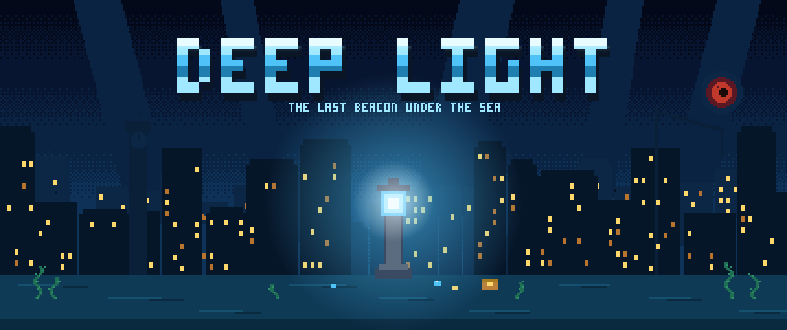

# 딥 라이트 (DEEP LIGHT)



> **숨이 다하기 전에, 빛을 되살려라.**
> 가라앉은 도시의 마지막 비콘을 지키는 도트 감성의 심해 탐험 어드벤처. (가로 화면 전용 · PC / Android)

## 한 줄 소개

도시가 소리 없이 가라앉던 밤, 마지막까지 남은 불빛은 항구의 비콘 하나였습니다. 당신은 그 불빛을 따라 내려온 등대지기. 관제 AI **아라**의 안내를 받아 폐허를 캐내고, 괴물을 물리치고, 꺼져 가는 비콘을 100%까지 되살리세요.

## 이야기

- 오프닝 컷신: 도시가 가라앉고, 빛을 먹는 ‘눈’이 깨어나고, 비콘이 꺼져 가는 순간 정체불명의 목소리가 신호를 잡습니다.
- 진행은 장(章) 단위로 이어집니다. 목표를 달성할 때마다 아라가 무전으로 이야기를 들려주고, 상자에서는 도시가 가라앉던 밤의 기록이 나옵니다.
- 한동안 막히면 아라가 다음 할 일을 힌트로 알려 줍니다.

## 게임 방식

1. **비콘 곁에서 시작합니다.** 산소는 비콘이나 환기구 근처에서만 충전됩니다. 숨이 다하기 전에 돌아오세요.
2. **채굴하고 싸웁니다.** 광맥에서 고철·황동·수정·진주를 캐고, 해파리·아귀·게·장어·유령 같은 적을 작살로 물리쳐 젤을 얻습니다.
3. **비콘에서 제작·강화합니다.** 곡괭이, 작살, 랜턴, 산소통, 추진 핀, 방호복을 강화하고 램프·환기구·산소 포션을 만들고, 비콘 자체를 넓힙니다.
4. **구역을 넓혀 갑니다.** 얕은 폐허 → 가라앉은 거리 → 심연. 거리에서는 중계기를 지키는 미니보스(집게왕, 장어왕)를 쓰러뜨리고, 심연에서는 감시 등대의 ‘눈’과 맞섭니다.
5. **비콘을 100%로 되살리면 클리어입니다.**

### 적 요약

| 적 | 특징 |
|---|---|
| 해파리 | 쫓아오지 않고 떠다닌다. 젤의 공급원 |
| 아귀 | 가까워지면 쫓아오다 직선으로 달려든다 |
| 장어 | 몸을 떨며 예고한 뒤 돌진한다. 옆으로 피하자 |
| 집게왕 / 장어왕 (미니보스) | 예고 후 충격파 / 돌진 후 부채꼴 탄막 |
| 심연의 눈 (보스) | 탄막. 움직이면서 싸우자 |

## 조작

| | 키보드 / 마우스 (PC) | 터치 (모바일) |
|---|---|---|
| 이동 | WASD / 방향키 | 왼쪽 화면을 끌기 (조이스틱) |
| 채굴 | 좌클릭(꾹) | 오른쪽 아래 큰 버튼 꾹 / 화면 직접 터치 |
| 작살 공격 | 우클릭(커서 방향) · Space | 큰 버튼 (적이 가까우면 자동 공격) |
| 램프 / 환기구 / 젤 회복 | Q / E / F | 각 버튼 |
| 제작 | 비콘 근처에서 1~0 | 비콘 근처의 제작 버튼 |
| 메뉴 · 소리 | Esc · M | 우상단 메뉴 버튼 |

Unity 에디터에서는 모바일과 같은 화면이 기본이며, 버튼 옆에 키보드 단축키가 함께 표시됩니다. T 키로 PC용 화면으로 바꿀 수 있습니다. 타이틀에서 I 키는 오프닝 다시 보기, N 키는 새 게임입니다.

## 특징

- 도트 아트 전 화면: 잠수부, 적, 보스, 타일, 아이콘을 모두 도트로 제작
- 살아 있는 타이틀과 오프닝 컷신: 레이어 모션, 물고기 떼와 해파리, 깜빡이는 비콘
- 물속 느낌: 이동 방향으로 몸을 돌려 헤엄치는 잠수부, 발쪽 거품, 떠다니는 물고기 떼, 빛이 번지는 조명
- 초반 안내와 이야기 흐름: 아라의 무전, 장 단위 목표, 막힐 때 힌트
- 가로 전용 UI와 안전 영역 대응, 효과음 내장

## 실행 · 빌드

- Unity **6000.0.68f1**. `Assets/Scenes/Main.unity` 를 열고 Play.
- 메뉴 **Abyss ▸ Build ▸ Windows (폴더)** 또는 **Android (APK)** 로 공유용 빌드를 만듭니다. 결과는 `Builds/` 아래에 생깁니다.
- 배치 빌드:
  ```
  Unity.exe -batchmode -nographics -projectPath <경로> -quit -executeMethod Abyss.EditorTools.BuildTools.BuildWindows
  Unity.exe -batchmode -nographics -projectPath <경로> -quit -executeMethod Abyss.EditorTools.BuildTools.BuildAndroid
  ```
- 저장 파일은 기기의 persistentDataPath 에 `abyss_save.json` 으로 저장됩니다.

## 폴더

| 폴더 | 내용 |
|---|---|
| `Assets/Scripts/Core` | 규칙과 월드 생성 (화면과 분리된 순수 C#) |
| `Assets/Scripts/View` | 타일맵, 엔티티, 조명, 효과음 |
| `Assets/Scripts/UI` | HUD, 타이틀, 인트로 컷신 |
| `Assets/Resources/Art` | 게임에서 쓰는 도트 PNG |
| `Art/Source` | 도트 원본 스크립트 (claude-pxl) |
| `Share` | 공유용 타이틀 이미지, 아이콘 |
| `abyss` | 초기 웹 프로토타입 |

## 알려진 제한

- 이 빌드는 공유·테스트용입니다. 스토어 제출용 서명, 아이콘 적용, 해상도별 최적화는 아직 하지 않았습니다.
- Android 는 실기기 확인을 아직 하지 않았습니다.
